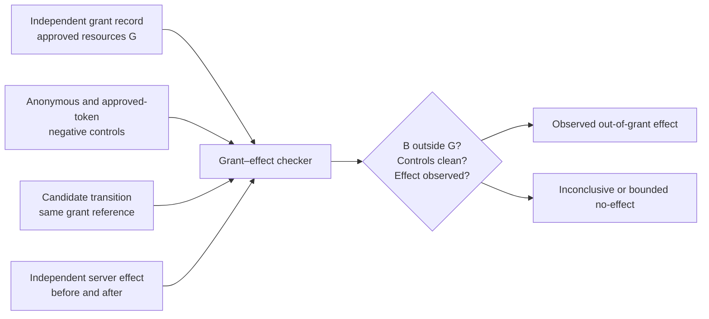

# OAuth Grant–Effect Audit

An offline evidence checker for a narrow authorization question:

> After a user approves an OAuth client for resource set **G**, did a later token transition cause a server-observed effect at resource **B**, where **B is outside G**?

The checker reads a redacted JSON record produced by an authorized test. It joins four pieces of evidence: the original grant, an attempted transition, two negative controls, and a server-side effect counter. A successful token or HTTP response alone is not treated as proof of an effect.

This is a small, reusable **evidence evaluation tool**, not an autonomous vulnerability scanner or a claim that a particular product is vulnerable. The included data is synthetic and contains no vendor-specific reproduction.

## Quick start

Python 3.10 or newer is required. The checker has no runtime dependencies.

```sh
python3 -m pip install -e .
grant-effect-audit examples/synthetic-finding.json --json
grant-effect-audit examples/synthetic-blocked.json
grant-effect-audit examples/synthetic-inconclusive.json
```

Example output for the synthetic finding:

```json
{
  "case_id": "synthetic-out-of-grant-effect",
  "status": "out_of_grant_effect_observed",
  "reasons": ["server_effect_after_unapproved_transition"],
  "target_resource": "https://resource-b.example.test/mcp",
  "effect_delta": 1,
  "http_requests": 9
}
```

Exit codes are `2` for an observed out-of-grant effect, `3` for inconclusive evidence, `64` for invalid input, and `0` for a bounded no-effect or within-grant result. A `0` does **not** certify that a service is secure against every authorization path.

## Evidence model



The input contract is in [docs/evidence-format.md](docs/evidence-format.md). Resource identifiers are compared exactly as supplied; adapters must use the authorization server's canonical identifiers consistently. The tool rejects token, password, cookie and client-secret fields and obvious bearer-token strings, but collectors must still review every record before sharing it.

For a positive finding, the checker requires:

1. A grant record or consent screen that explicitly lists the approved resources, with a reference linking the candidate to that grant.
2. An isolated run with independent server-side effect measurements.
3. An anonymous request and a request using the original approved-resource token that both produce no effect at B.
4. A candidate transition that produces an effect at B while B is outside the original grant.

For a bounded no-effect result, it also requires a separate, legitimate B-authorization control that demonstrates B can perform the measured effect. Missing evidence yields **inconclusive**, so a broken test fixture is not counted as a successful defense.

This classifier checks the structure and declared provenance of evidence. It cannot verify that a referenced consent screen or server database export is authentic; experiments should retain those originals privately for review.

## Running tests

```sh
PYTHONPATH=src python3 -m unittest discover -s tests -v
```

## Standards and scope

- [RFC 8707, Resource Indicators for OAuth 2.0](https://www.rfc-editor.org/info/rfc8707/) describes resource-specific access-token requests and explains that a refresh token remains bound to the full original grant, which may contain more than one resource.
- [MCP authorization specification, 2025-11-25](https://modelcontextprotocol.io/specification/2025-11-25/basic/authorization) requires resource indicators in authorization and token requests and audience validation by protected MCP servers.

The checker asks whether a **measured effect** occurred outside an independently observed grant. It does not assume that two different resource URIs imply a violation: B may already belong to G, or a separate authorization may have been completed.

## Responsible use

Run experiments only on services and accounts you are authorized to test. Use isolated fixtures for effectful checks. Keep raw grants, tokens, cookies, customer data and undisclosed vendor findings out of public repositories. Share product-specific evidence through the vendor's private security channel before public release.

## License

MIT. See [LICENSE](LICENSE).
